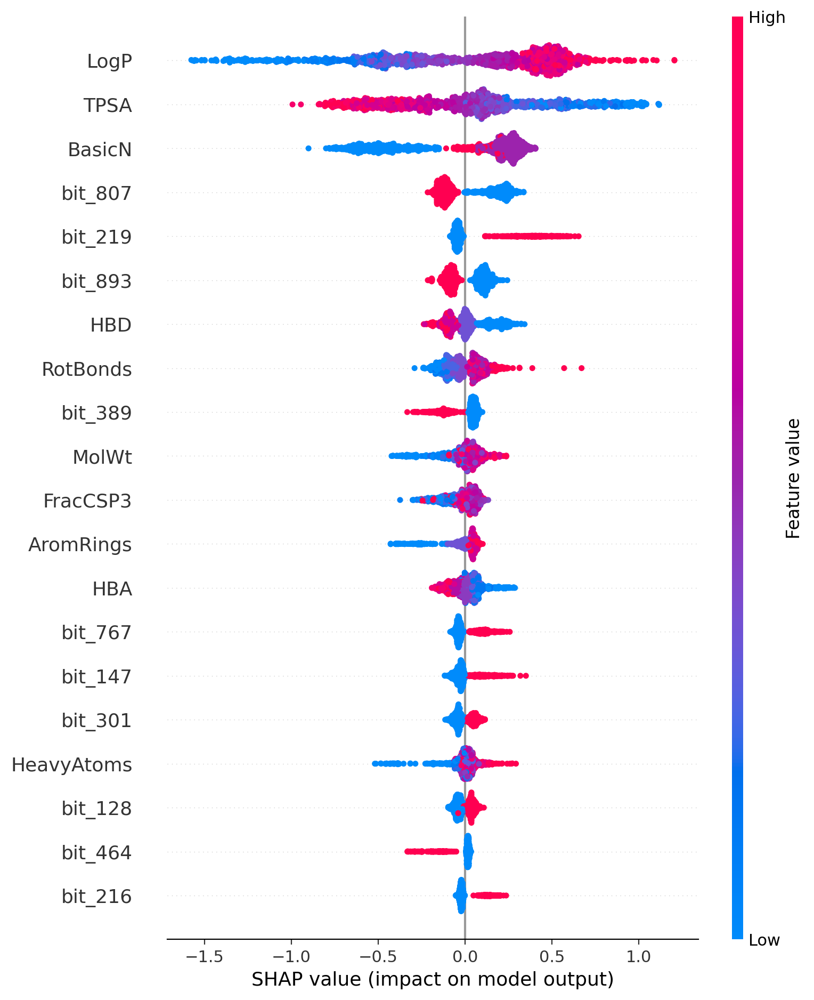

# 🫀 CardioGuard: hERG Cardiotoxicity Prediction


CardioGuard predicts whether a small molecule is likely to block the hERG potassium channel, and explains each prediction with SHAP.

## Biological motivation
The hERG potassium channel helps the heart reset between beats. Drugs that block it can cause QT prolongation and a fatal arrhythmia called torsades de pointes. Several marketed drugs (for example terfenadine and cisapride) were withdrawn for this reason, and hERG liability is a common cause of drug candidate failure. Predicting it early from chemical structure alone saves time and cost.

## Data
- **Dataset:** hERG_Karim from the Therapeutics Data Commons (about 13,400 compounds labelled blocker or non-blocker)
- **Cleaning:** SMILES standardization (largest fragment kept, charges neutralized), duplicate removal, and removal of molecules with conflicting labels
- **Final dataset:** 13,136 molecules

## Methods
- **Features (1,034):** 10 physicochemical descriptors (molecular weight, LogP, TPSA, H-bond donors and acceptors, rotatable bonds, aromatic rings, Fsp3, heavy atoms, basic amine count) plus 1,024-bit Morgan fingerprints (radius 2)
- **Split:** Bemis-Murcko scaffold split, 80/10/10 (10,508 train / 1,313 validation / 1,315 test), with an automatic check that no scaffold appears in more than one set
- **Models:** Logistic Regression, Random Forest, XGBoost
- **Tuning:** XGBoost random search (15 configurations) using the validation set only. The decision threshold (0.58) was also chosen on validation data by maximizing MCC
- **Explainability:** SHAP TreeExplainer, with Morgan bits mapped back to atoms for visualization

## Results (scaffold-split test set)

| Model | ROC-AUC | PR-AUC | F1 | MCC |
|---|---|---|---|---|
| Logistic Regression | 0.771 | 0.772 | 0.688 | 0.393 |
| Random Forest | 0.869 | 0.864 | 0.795 | 0.603 |
| XGBoost (deployed) | 0.858 | 0.860 | 0.753 | 0.551 |

XGBoost ROC-AUC 95% bootstrap confidence interval: 0.837 to 0.878.

Random Forest scored slightly higher than XGBoost on the test set, and its AUC lies inside the XGBoost confidence interval, so the two are statistically comparable. XGBoost was deployed because it was selected using validation data only and works directly with SHAP.

### Why scaffold splitting matters

| Split type | XGBoost ROC-AUC | F1 | MCC |
|---|---|---|---|
| Random split | 0.930 | 0.848 | 0.706 |
| Scaffold split | 0.858 | 0.753 | 0.551 |

A random split lets near-identical molecules appear in both training and test sets, which inflates performance by about 0.07 AUC. The scaffold split better matches the real task: predicting hERG risk for new chemical series.

## Explainability
SHAP shows which features push a prediction toward "blocker". For example, terfenadine (a drug withdrawn for cardiotoxicity) is predicted as a blocker with 91% probability. The strongest contributions come from its high lipophilicity (LogP 6.4), its basic amine, and its low polar surface area (TPSA 43.7). These match the known hERG pharmacophore of lipophilic molecules with a basic nitrogen.

Across the test set, the most influential features were lipophilicity (LogP), polar surface area (TPSA) and the number of basic amines (BasicN), followed by several Morgan fingerprint substructures and descriptors such as hydrogen-bond donors and rotatable bonds. The three leading features match the known hERG pharmacophore of lipophilic molecules containing a basic nitrogen, which suggests the model learned established medicinal chemistry rather than dataset artifacts.



## Limitations
- Labels come from mixed assays and are noisy
- Predictions are only reliable for molecules similar to the training chemistry
- Research tool only, not for clinical or regulatory decisions

## Run locally
```bash
pip install -r requirements.txt
streamlit run app.py
```

## Repository structure
- `app.py`: Streamlit app
- `src/`: data cleaning, features, scaffold split, training, SHAP code
- `models/`: trained model and metrics
- `data/`: cleaned dataset and train/validation/test labels
- `reports/figures/`: ROC curve, confusion matrix, SHAP plots
